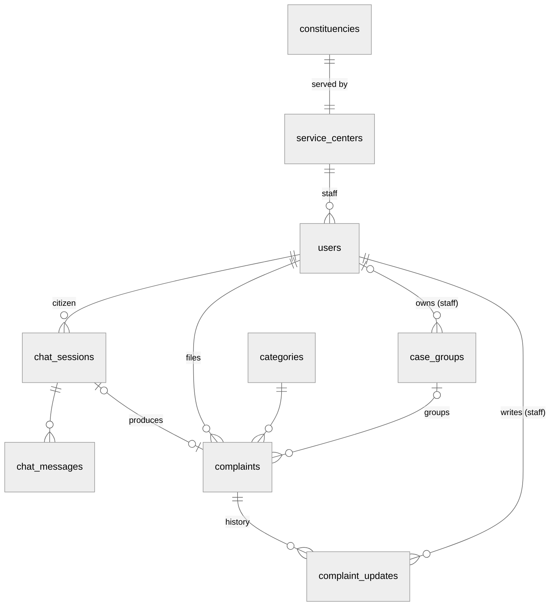
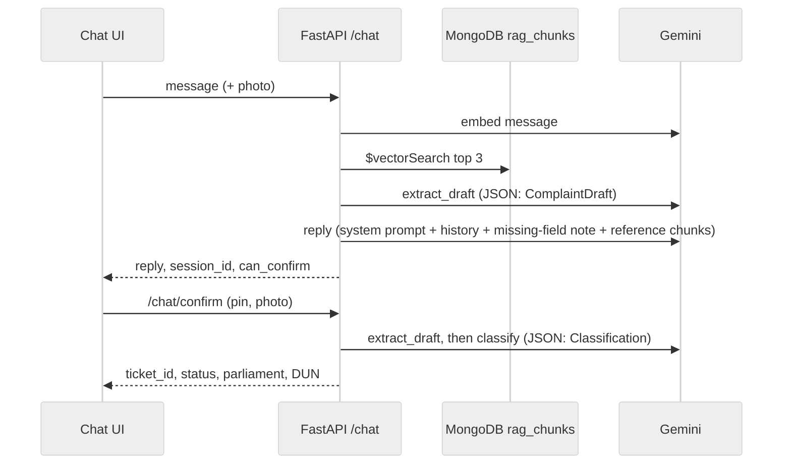

# WaKiL Architecture

Background for [Current_Design.md](Current_Design.md). Describes the code **as built in this repo** (October 2026). The target architecture lives in `wakil-workplace/Architecture.md`.

# Purpose

WaKiL is a **complaint pipeline** from citizens to their wakil rakyat's office. The AI chat is the **intake**; a plain form is the second way in. Staff triage complaints into **case groups** and work them to Resolved.

- **Scope now:** one seeded office, the ADUN for **N.34 Bukit Gasing** (Selangor). Constituency lookups cover Peninsular Malaysia (2018 delimitation).
- **Platform:** a responsive React web app with two portals (citizen and YB office) plus a public landing page.
- **Language:** the AI replies in English or Bahasa Malaysia, matching the user. The UI is English.

# Actors

| Actor | Who | How they log in |
| --- | --- | --- |
| Citizen | Chats with WaKiL AI, files complaints by chat or form | None yet: every request runs as the fixed user `test123@gmail.com` |
| Representative | The YB. Sees everything, assigns case groups, resolves complaints, manages staff. Never owns a group | Staff email (no password), signed token |
| Aide | Creates and claims case groups, can take over or transfer any group, confirms members | Same |
| Intern | Creates and claims case groups, works their own groups, flags for review | Same |

- Staff roles are `users.role`; all staff belong to one service centre (`users.service_center_id`).
- Work is assigned **only through case groups**: the group owner is the single worker for every complaint in it.

# Organisation

- A **service centre** serves exactly one **constituency** (`service_centers.constituency_id` is unique).
- The seed creates one constituency (`N.34 Bukit Gasing`), one centre (`ADUN Bukit Gasing Office`) and six staff: one Representative, three Aides, two Interns.
- Complaints have **no owning centre**: every staff member sees every complaint. The office's constituency is used only to draw its Kawasan map and grey out pins outside it.

# Geodata

- **Source:** [ElectionData.MY](https://electiondata.my/data-catalogue/) Peninsular 2018 delimitation, parliament (`P.xx`) and DUN (`N.xx`) boundaries.
- **Ingest:** `backend/scripts/ingest_kawasan.py` downloads the GeoJSON from `lake.electiondata.my`, rounds coordinates to 5 dp and writes GeoParquet to `backend/app/data/`. The files are committed; there are no live calls.
- **Loaded in memory** by GeoPandas on first use; nothing geographic is stored in Postgres beyond the constituency name and a `geojson_ref` label.
- **Uses:**
  - Citizen ticket: point-in-polygon on the pinned coordinates → parliament + DUN name (Federal Territories → parliament only). Shown, not stored.
  - Staff map: `/api/kawasan/geojson` serves a state's features or one feature by code (public, cached 1 day); `/api/kawasan/pins` flags each complaint pin as inside or outside the office's boundary (ray-cast).
- **Maps in the app:**
  - Location pin picker (citizen): **Leaflet** + OpenStreetMap tiles, with **Nominatim** for search and reverse geocoding.
  - Kawasan map (staff): **MapLibre GL** with a blank style, no tiles.

# Data Model

PostgreSQL is the source of truth. `backend/sql/schema.sql` defines it (all primary keys UUID); `app/models.py` mirrors it for SQLAlchemy. The ER diagram is [Wakil_ERDiagram_Mermaid.drawio](Wakil_ERDiagram_Mermaid.drawio).

| Table | Key fields |
| --- | --- |
| **constituencies** | `id`, `name` (e.g. `N.34 Bukit Gasing`), `geojson_ref` |
| **service_centers** | `id`, `name`, `address`, `constituency_id` (unique) |
| **users** | `id`, `email` (unique), `name`, `password_hash` (unused), `profile` (`citizen` \| `staff`), `role` (`Representative` \| `Aide` \| `Intern`), `service_center_id`, `is_active` |
| **categories** | `id`, `name` (unique); seeded from the 7 fixed categories |
| **chat_sessions** | `id`, `user_id`, `title` (default `New Conversation`, then the first message), `created_at`, `updated_at` |
| **chat_messages** | `id`, `session_id` (cascade delete), `sender` (`user` \| `assistant`), `body`, `image_url` (base64 data URI), `created_at` |
| **complaints** | `id`, `user_id`, `category_id`, `case_group_id`, `chat_session_id` (unique, set null on chat delete), `title`, `body`, `status` (`Pending` \| `In Progress` \| `Resolved`), `rep_attention`, `attachment` (base64 data URI), `latitude`, `longitude`, `created_at` |
| **case_groups** | `id`, `user_id` (owning staff; null = unowned), `title` |
| **complaint_updates** | `id`, `complaint_id` (cascade delete), `user_id` (staff), `body` (`[action] detail`), `attachment`, `created_at` — the complaint's history |

- **Constraints in the database:**
  - `users_staff_fields`: staff rows need a role and a service centre; citizen rows have neither.
  - `complaints_coords`: latitude and longitude are set together and within range.
  - Trigger `require_staff_author` on `case_groups` and `complaint_updates`: `user_id` must be a staff user. SQLAlchemy can't express it, which is why tables are built from the SQL file, not `create_all`.
- **Derived, not stored:** complaint ref no. (`YYYY-XXXXXX`), group status (Closed when all members Resolved), group category (first member's), session status (completed when a complaint links to it), parliament / DUN, priority, notifications.
- History actions in `complaint_updates.body`: `status`, `claim`, `reassign`, `group-assign`, `group-remove`, `group-confirm`, `flag`, `unflag`, `update`, `resolve`, `release`.
- **Schema setup:** on startup, if the `users` table is missing, the backend loads `sql/schema.sql` into the empty database (`app/db.py:init_db`). `create_tables.py` runs the same step by hand. `scripts/seed.py` adds categories, the constituency, the centre, staff and the demo citizen (safe to re-run).
- There are no migrations; changing the schema means editing `schema.sql` and `models.py` together.

# API

FastAPI app in `backend/app/main.py`, plus the YB router in `backend/app/yb_portal/`.

| Group | Endpoints | Auth |
| --- | --- | --- |
| Health | `GET /health`, `GET /api/health` | none |
| Citizen chat | `POST /chat`, `POST /chat/confirm`, `GET/POST /chat/sessions`, `GET/DELETE /chat/sessions/{id}` | fixed test user |
| Citizen form | `GET /complaints/categories`, `POST /complaints/suggest-category`, `POST /complaints` | fixed test user (suggest: none) |
| Staff auth | `POST /api/auth/google` (email lookup), `GET /api/me` | bearer token |
| Complaints | `GET /api/aduan`, `GET/PATCH /api/aduan/{id}`, `POST /api/aduan/{id}/resolve`, `POST /api/aduan/{id}/updates` | bearer token |
| Case groups | `GET/POST /api/case-groups`, `PATCH /api/case-groups/{id}` (transfer), `POST …/{id}/pull`, `…/{id}/confirm`, `…/{id}/claim-all` | bearer token |
| Kawasan | `GET /api/kawasan`, `GET /api/kawasan/pins`, `GET /api/kawasan/geojson` (public) | bearer token / none |
| Reference | `GET /api/categories`, `GET /api/service-centers` | bearer token |
| Staff | `GET /api/staff`, `POST /api/staff` (invite), `PATCH /api/staff/{id}` (active) | bearer; writes need Representative |

- Citizen routes sit at the root; staff routes under `/api`. Role rules are in `yb_portal/domain.py` (`can_*` helpers) and enforced in `router.py`.
- Staff tokens: `base64(json{sub, exp}).HMAC-SHA256`, 12 hours, signed with `STAFF_TOKEN_SECRET` (a random per-process secret if unset, which signs everyone out on restart).
- CORS allows `localhost` / `127.0.0.1` on ports 5173 and 3000.
- The frontend's YB data context loads complaints, groups, staff, kawasan and categories in one go, applies each action locally, saves it, then reloads everything.

# AI pipeline

Google **Gemini** through the `google-genai` SDK (`app/services/gemini_client.py`). Model `gemini-3.5-flash-lite`; embeddings `gemini-embedding-001`.

| Call | Output | Notes |
| --- | --- | --- |
| `call_gemini` | Reply text | `SYSTEM_PROMPT` in `app/prompts.py`; a hidden system note says which fields are missing |
| `extract_draft` | `ComplaintDraft` (what happened, location, when, evidence) | Structured JSON; keeps `Place (lat, lng)` coordinates |
| `classify` | `Classification` (category, priority, summary, confidence) | `CLASSIFICATION_PROMPT`; < 0.6 confidence or unknown category → Others |
| `embed_texts` | Vectors | For RAG |

- Each turn makes 3–4 model calls (embed, extract, reply); Confirm makes 2 more.
- Photos are sent inline as image parts decoded from the data URI.
- 429 / quota errors retry 3 times with random exponential back-off (tenacity), then surface as HTTP 429.
- No streaming; the whole reply comes back at once.

# Tech Stack

- React 19 (Frontend), built with Vite 8
  - Tailwind CSS 4 (utility classes; own small component kit in `components/ui`)
  - React Router 7
  - Recharts — dashboard charts
  - MapLibre GL — Kawasan map
  - Leaflet + OpenStreetMap / Nominatim — location pin picker
  - dnd-kit — reorderable dashboard widgets
  - lucide-react — icons
  - Plain `fetch` clients: `services/chatApi.js` (citizen, `VITE_API_URL` or `http://localhost:8000`) and `lib/ybApi.js` (staff, `/api` proxied by Vite in development)
- FastAPI (Backend), Python 3.12, uvicorn
  - Pydantic (request / response models, Gemini structured output)
  - SQLAlchemy 2 + psycopg 3
  - google-genai (Gemini chat, structured output, embeddings), tenacity (retries)
  - GeoPandas, Shapely, PyArrow (constituency boundaries)
  - pymongo (vector search)
  - No background worker

## Storage

- **PostgreSQL**: everything, including photos as base64 text in `chat_messages.image_url`, `complaints.attachment`.
- **MongoDB (Atlas Vector Search)**:
  - `wakil.rag_chunks` (index `rag_index`): the `##` sections of `backend/docs/*.md`, embedded. Rebuilt with `python -m app.services.rag` from `backend/`.
  - `wakil.complaint_embeddings` (index `complaint_index`): meant for duplicate detection; `services/duplicates.py` and `backfill.py` are not wired in and reference fields the current `Complaint` model doesn't have.
  - RAG runs on every chat turn, so the chat needs MongoDB to be reachable.
- **GeoParquet files** in `backend/app/data/`: constituency boundaries.
- **Browser**: staff token in `sessionStorage`; dashboard layout per user in `localStorage`.
- No object storage, no Redis, no cache.

## Configuration

| Variable | Where | Use |
| --- | --- | --- |
| `GEMINI_API_KEY` | backend `.env` | Gemini |
| `DATABASE_URL` | backend `.env` | `postgresql+psycopg://…` |
| `MONGODB_URL` | backend `.env` | RAG and embeddings |
| `STAFF_TOKEN_SECRET` | backend `.env` | Signs staff tokens |
| `VITE_API_URL` | frontend `.env` | Backend base URL |

# Hosting and Delivery

- **Frontend:** Firebase Hosting config (`frontend/firebase.json`, serves `dist`, SPA rewrite to `index.html`).
- **Backend:** no deployment config in the repo; runs locally with uvicorn on port 8000.
- **CI:** GitLab Auto DevOps template with SAST and secret detection (`.gitlab-ci.yml`). `main` is protected; changes land through merge requests.
- **No tests** in the repo.
- Data residency, PDPA, real authentication and secrets management are not addressed yet.
