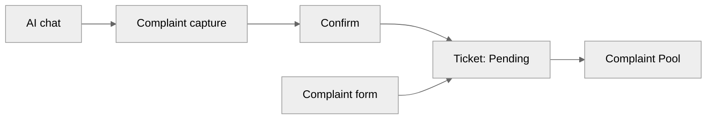
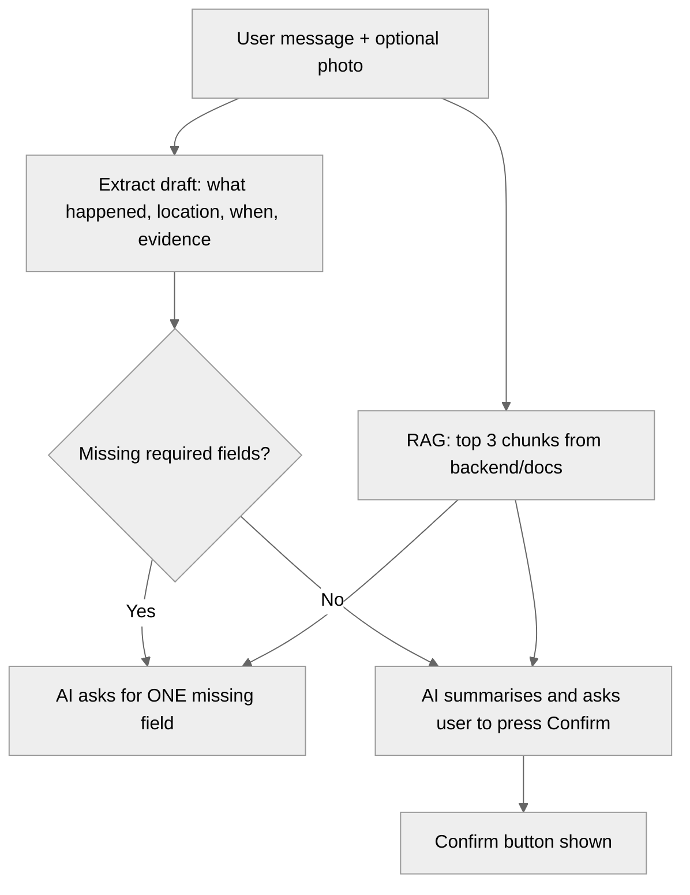
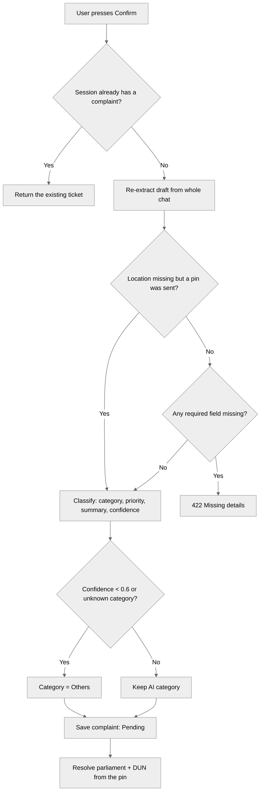
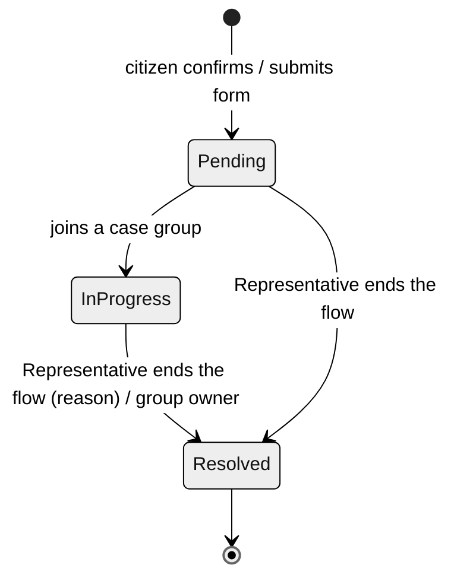
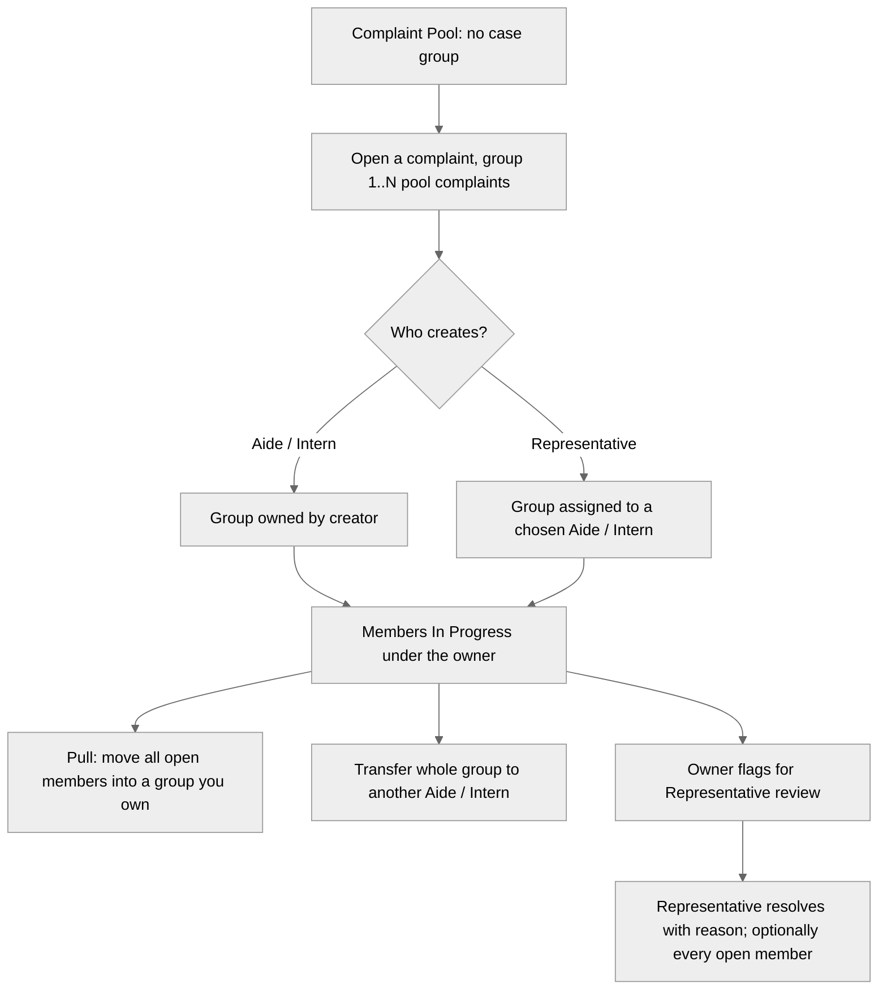

# WaKiL Current Design

Pages, functions and rules **as built in this repo** (branch `initialise-database-fix`, October 2026). Background: [Architecture.md](Architecture.md). The target design lives in `wakil-workplace/System_Design.md`; [Gaps against the target](#Gaps%20against%20the%20target) lists where the code differs. MVP has one organisation, the seeded ADUN office for **N.34 Bukit Gasing**.

# Sitemap

> [!TIP] Format
> Dots are pages, numbers are features. Links jump to the rule that governs them. Pages marked **(mock)** show hard-coded sample data; **(placeholder)** pages say "This page is not built yet".

## Public

- Landing (/) — everyone
  1. Hero, Smart Ecosystem, Stats and About sections (static copy from `data/landingContent.js`)
  2. Floating "Chat with WaKiL AI" button → `/citizen/wakil-ai`
  3. Citizen login popup with a MyDigitalID button → goes straight to `/citizen/dashboard`, no sign-in → [Sign-in](#Sign-in)
  4. EN / BM toggle (stores the choice only; copy is English) → [Language](#Language)
  - YB login (/yb/login) → [Sign-in](#Sign-in)
    1. Staff email (no password)

## Citizen

- WaKiL AI (/citizen/wakil-ai) — full-screen chat, outside the citizen sidebar → [AI chat](#AI%20chat)
  1. Chat history sidebar: list, open, delete
  2. Empty state with starter prompts
  3. Photo attach (compressed in the browser, sent as base64)
  4. 📍 Pin location on a Leaflet map (search, GPS, reverse geocode via Nominatim)
  5. Confirm button when the AI has every required field → [Complaint capture](#Complaint%20capture)
  6. Ticket card with ticket ID, status, parliament and DUN
- Citizen portal (/citizen) — sidebar layout
  - Dashboard (/citizen/dashboard) **(mock)**
    1. Greeting, "Submit a new complaint" and "Chat with WaKiL AI" cards
    2. Status counts, complaint list (Active / Completed), latest updates, representative card
  - Submit Complaint (/citizen/hantar-aduan) → [Complaint form](#Complaint%20form)
    1. What happened, location (map picker), when, photo
    2. AI category / priority / summary suggestion (debounced)
    3. Category picker
    4. Submitted ticket card
  - My Complaints (/citizen/aduan-saya) **(placeholder)**
  - Notifications (/citizen/notifikasi) **(placeholder)**
  - My Profile (/citizen/profil) **(placeholder)**

## YB office staff (Representative, Aide, Intern)

- Dashboard (/yb/dashboard) — everyone lands here → [Dashboards](#Dashboards)
  1. Representative: constituency overview with widgets (drag to reorder, hide / show; layout saved per user in the browser)
  2. Aide / Intern: personal queue (my open, gone stale, pool to group, with Representative), my tasks, pool, recent activity
- Assigned Complaints (/yb/complaints/assigned) → [Case groups](#Case%20groups)
  1. Stat tiles, category filter, search
  2. Flagged for review (Representative)
  3. My case groups (collapsed; expand to see members)
  4. Other open groups, read-only, to pull from
  - Complaint dialog → [Complaint dialog](#Complaint%20dialog)
- Complaint Pool (/yb/complaints/pool) → [Case groups](#Case%20groups)
  1. Ungrouped complaints; category filter, search
  2. Open a complaint to group 1..N pool complaints and claim en-bloc
- Staff (/yb/staff) — Representative → [Staff management](#Staff%20management)
  1. Roster with active count
  2. Invite (email, name, role Aide / Intern)
  3. Deactivate / reactivate
- Analytics (/yb/analytics) → [Dashboards](#Dashboards)
  1. Charts tab: mix, weekly trend, aging
  2. Map tab: Kawasan boundary with complaint pins
- Notifications (/yb/notifications) → [Notifications](#Notifications)
  1. Morning pool digest, evening review digest
  2. Activity feed with filters: All, Pool, Review flags, Updates sent, Claims & moves, Resolved
- Settings (/yb/settings) **(placeholder)**

# Rules

## Roles and permissions

Staff roles are fixed per account: **Representative** (the YB), **Aide**, **Intern**. All staff belong to one service centre.

| Action | Citizen | Intern | Aide | Representative |
| --- | :---: | :---: | :---: | :---: |
| Chat, file complaint (chat or form) | ✅ | | | |
| See every complaint, case group and staff member | | ✅ | ✅ | ✅ |
| Create a case group | | own | own | unowned, or assigned to an Aide / Intern |
| Add a complaint to an open group | | owner | owner | ✅ |
| Pull an open group into another | | dest owner | dest owner | ✅ |
| Claim a group en-bloc | | unowned / own | ✅ (incl. taking over) | |
| Transfer a group to another Aide / Intern | | owner | ✅ | ✅ |
| Confirm group members | | | ✅ | ✅ |
| Flag for Representative review | | owner, In Progress | owner, In Progress | |
| Clear the flag | | owner | owner | ✅ |
| Post an update | | owner | owner | API only |
| Move a complaint out of a group (release panel) | | owner | owner | ✅ |
| Resolve (end the flow with a fixed reason) | | | | ✅ |
| Invite / deactivate staff, see Staff page | | | | ✅ |

- The Representative never holds a case group.
- The UI gates the update composer to the group owner; the API accepts an update from any staff member.
- The API also lets a group owner set Resolved through `PATCH /api/aduan/:id`; the UI shows Resolve to the Representative only.

## Sign-in

| Who | How it works now |
| --- | --- |
| Citizen | No sign-in. Every citizen request runs as the fixed user `test123@gmail.com` (created on first use). The landing login popup and MyDigitalID button just open the dashboard |
| Staff | `/yb/login` takes a staff email; the backend looks it up and returns a signed token (HMAC-SHA256, 12 hours). **No password check.** Token kept in `sessionStorage`; `/api/me` restores the session on reload |
| Deactivated staff | Login and every API call return 401 |

## Citizen journey

### AI chat

| Rule | Detail |
| --- | --- |
| Scope | Complaints and how WaKiL / wakil rakyat work. Off-topic requests are declined politely with an offer to file a complaint |
| Required fields | What happened, location, when. Evidence (photo) is optional and never blocks |
| One question | One short question per reply; never re-ask what was given; never ask for severity |
| No false promises | The AI never says a complaint is submitted; a ticket exists only after Confirm |
| Emergencies | Tells the user to call 999 first |
| Language | Replies in the language of the user's latest message (English or formal Bahasa Malaysia); any other language → English |
| Q&A | Answers from the retrieved reference chunks (`faq.md`, `how_wakil_works.md`, `categories.md`); says it is unsure if they don't cover it |
| Sessions | A message without a session ID starts a new session. The title is the first user message, cut to 45 characters |
| History | Sidebar lists sessions newest first; a session with a complaint shows as "completed" with its ticket ID |
| Deleting a chat | Deletes the session and its messages; the complaint stays (its `chat_session_id` becomes null) |
| AI errors | Gemini 429 / quota errors retry 3 times, then return 429 "Gemini rate limit exceeded"; other Gemini errors return 502 |

### Complaint capture

| Field | Rule |
| --- | --- |
| Title | The AI's one-sentence summary (max 200 characters) |
| Body | What happened + "Location: …" + "When: …" |
| Category | One of the 7 fixed categories → [Categories](#Categories) |
| Priority | Low / Medium / High from the AI. Returned by the form endpoint, **not stored** |
| Location | Text, e.g. `Taman Mawar (3.1209, 101.6738)`. Coordinates in brackets are parsed into `latitude` / `longitude` |
| Photo | The last photo in the chat if the client doesn't resend it; stored as a base64 data URI |
| Parliament / DUN | Looked up from the coordinates against the Peninsular 2018 boundaries (Federal Territories give parliament only). Shown on the ticket, not stored |
| One per chat | `chat_session_id` is unique; a double Confirm returns the same ticket |
| Ticket ID | The complaint UUID. Staff see a ref no. `YYYY-XXXXXX` (year + first 6 hex of the ID) |

### Complaint form

| Rule | Detail |
| --- | --- |
| Required | What happened, location, when (422 otherwise) |
| AI suggestion | As the user types (or adds a photo), `/complaints/suggest-category` returns category, priority, confidence and summary; a photo alone is enough. Below 0.6 confidence → Others |
| Override | The user's category and priority win if valid; otherwise the AI's |
| Result | Same complaint record as the chat path, without a chat session |

## Complaint handling

### Complaint lifecycle

| Status | Rule |
| --- | --- |
| Pending | New; in the pool while it has no case group |
| In Progress | Set automatically when the complaint joins a group |
| Resolved | **Terminal**: no status change, no regrouping, no flag |

- Returning a complaint to the pool (or releasing it when its owner is deactivated) clears the group but **keeps** In Progress.
- Every change writes a `complaint_updates` row (`[action] detail`), which is the complaint's history.

### Case groups

| Rule | Detail |
| --- | --- |
| Assignment | Only through a case group: its owner is the single assignee of every member. Pool complaints are never claimed one by one |
| Group status | Derived: **Closed** when every member is Resolved, otherwise **Open**. Closed groups accept no members |
| Group category | The first member's category |
| Claim en-bloc | The claimant becomes owner; each open member gets a "claim" history line |
| Pull | Every open member of the source moves to the destination; both groups must be open |
| Transfer | Whole group only; the target must be an active Aide or Intern |
| Confirm | Records "confirmed in group" in each member's history; nothing is stored on the group |
| Shared updates / resolve | "Repeat in group" applies one update or one resolve to every open member |
| Deactivation | All of the staff member's groups become unowned and their complaints return to the pool |

### Complaint dialog

| Element | Rule |
| --- | --- |
| Details | Ref no., title, body, category, citizen name, date, status, photo, map pin |
| Panels | Grouping (pool), Pull, Release / resolve (Representative), Representative flag, update composer |
| History | Every `complaint_updates` line with staff name and date |
| Attachments on updates | Only the file name is saved in the text; no file upload yet |

### Who sees what

| Data | Citizen | Staff |
| --- | :---: | :---: |
| Own ticket status (chat ticket card) | ✅ | ✅ |
| Every complaint in the system | ❌ | ✅ (not filtered by service centre yet) |
| Citizen name | own | ✅ (falls back to a name built from the email) |
| Staff names, history | ❌ | ✅ |
| Priority | form result only | ❌ (not stored) |

## Dashboards

| Widget | Representative dashboard | Aide / Intern dashboard | Analytics |
| --- | :---: | :---: | :---: |
| Kawasan map (DUN boundary + pins) | ✅ | | Map tab |
| By status / category (bar / pie) | ✅ | | Charts tab |
| Weekly trend (status / category) | ✅ | | Charts tab |
| Aging chart + aging table | ✅ | | Charts tab |
| Needs attention | ✅ | | |
| Staff workload (per group owner) | ✅ | | |
| My open / gone stale (In Progress 60d+) / pool / flagged tiles | | ✅ | |

- Charts use Recharts; the map uses MapLibre GL on a blank style (no tiles), falling back to text without WebGL.
- Pins outside the office's Kawasan are grey; the map never refits to pins.
- All numbers are computed in the browser from `/api/aduan`.

## Notifications

| Who | How |
| --- | --- |
| Staff | Derived in the browser from complaints, history and group ownership (no notification table): morning pool digest (unassigned Pending + new since yesterday), evening review digest (flagged complaints), activity feed, stale watch. Sidebar badge = new pool arrivals + flags awaiting review |
| Citizen | Not built (placeholder page; sidebar count is hard-coded) |

## Staff management

| Rule | Detail |
| --- | --- |
| Invite | Representative only; email + role (Aide or Intern) + optional name. Creates the account at once; no email is sent. Duplicate email → 409 |
| Representative | Cannot be invited from the UI; comes from the seed |
| Deactivate | Representative only; reversible; releases the person's groups to the pool |
| Intern expiry | Not stored, not offered |

## Categories

Fixed list in `app/prompts.py`, seeded into `categories`:

| Category | Covers |
| --- | --- |
| Infrastructure/Roads | Potholes, streetlights, traffic lights, signs, walkways, bridges, bus stops, playgrounds |
| Drainage & Flood | Blocked drains, culverts, flash floods, standing water |
| Waste & Sanitation | Uncollected rubbish, illegal dumping, pests, overgrown lots, dirty toilets |
| Public Safety | Break-ins, theft, vandalism, drugs, mat rempit, patrols, abandoned structures |
| Utilities | Water supply and pressure, burst mains, blackouts, transformers, fallen cables |
| Welfare & Aid | JKM, e-Kasih, hardship, OKU, elderly, low-income support |
| Others | Anything else, and every low-confidence result |

One category per complaint. AI priority: **High** = danger to life, flood entering homes, live wires, total water outage; **Medium** = disrupts daily life; **Low** = minor or cosmetic.

## Language

- The AI follows the user's language (English / Bahasa Malaysia).
- The UI is English only. The EN / BM toggle stores the choice in React state and changes nothing yet. Some route names are Malay (`hantar-aduan`, `aduan-saya`, `notifikasi`, `profil`), and staff screens say "Aduan" and "Kawasan".

## Gaps against the target

Where this repo differs from `wakil-workplace/System_Design.md`:

| Area | Target | Now |
| --- | --- | --- |
| Citizen identity | MyDigitalID, signup with home / voting DUN | One hard-coded test user, no signup |
| Staff login | Email + password, invites, reset | Email only, no password; invite creates the account directly |
| Roles | Staff / Org Admin / System Admin | Representative / Aide / Intern; no System Admin |
| Routing | Complaint goes to the home DUN's centre | No owner centre; staff see every complaint |
| Claiming | Staff request, Org Admin approves | Case groups, claimed en-bloc |
| Statuses | Submitted / In Progress / Resolved / Withdrawn, reopen | Pending / In Progress / Resolved, no reopen or withdraw |
| Categories | Up to 15 per complaint, AI + staff sets | One per complaint, AI only |
| Severity / priority | Stored, staff-set | Priority computed, not stored; no severity |
| Complaint thread | Citizen ↔ staff in the chat | Staff updates visible to staff only |
| Duplicates | Distance + embedding similarity | `services/duplicates.py` exists but is not wired in and uses fields the model no longer has |
| Broadcasts, surveys, Q&A allowlist | Built | Not started |
| Citizen dashboards, My Complaints, notifications | Built | Mock or placeholder |
| Photos | Object storage | Base64 text in Postgres |
| i18n | Full BM / EN | English UI, toggle stores choice only |
| Geography | National, versioned imports | Peninsular 2018 only, files in the repo |
